  

<h1 align="center">Hi there, I'm Habibullah 👋</h1>

  

---

### 👨‍💻 About Me

- 🌐 Comfortable with **Django** and the **MERN stack**, which is where my web development journey started
- ⛓️ Currently learning **blockchain development**: Solidity, smart contracts and dApps
- 🛠️ Practicing by building small projects (see below) as I go
- 🎯 Goal: become a confident blockchain and full-stack developer, one project at a time
- 📫 Reach me here on GitHub or through the links below

---

### 🧠 Languages I Know

  
  
  
  

### 🧩 Frameworks & Stack I Know

  
  
  
  
  
  

### 🌱 Currently Learning (Blockchain Roadmap)

  
  
  
  
  

### 🧰 Tools

  
  
  

---

### 🚀 Projects

| Project | Description |
|---|---|
| [hero-dev-portfolio-dev](https://github.com/CodeMarshal079/hero-dev-portfolio-dev) | Developer portfolio website (HTML) |
| [g3-architecture-website](https://github.com/CodeMarshal079/g3-architecture-website) | Architecture website (HTML) |
<!-- Add your MERN, Django and blockchain projects here once they are pushed, e.g.:
| [my-first-dapp](https://github.com/CodeMarshal079/my-first-dapp) | Simple Solidity + Hardhat dApp | -->

---

### 🔗 Connect With Me

  
  
  <!-- Add more: X, Facebook, Discord, WhatsApp, portfolio link -->

---

### 📊 GitHub Stats

  <picture>
    <source media="(prefers-color-scheme: dark)" srcset="https://raw.githubusercontent.com/CodeMarshal079/CodeMarshal079/output/github-contribution-grid-snake-dark.svg" />
    <source media="(prefers-color-scheme: light)" srcset="https://raw.githubusercontent.com/CodeMarshal079/CodeMarshal079/output/github-contribution-grid-snake.svg" />
    
  </picture>

  
  

---

<em>Thanks for stopping by — more projects coming as I learn! 🚧</em>

